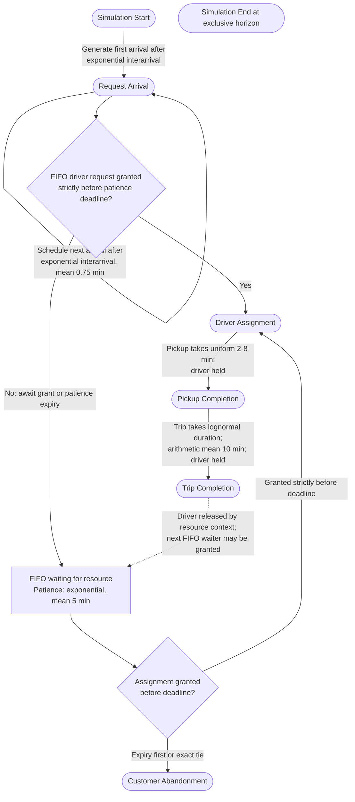

# Event Graph — code-aligned model

The diagram distinguishes **recorded lifecycle events** (rounded nodes) from
**internal SimPy decisions/state** (diamonds/rectangles). The labels in parentheses
match `SimulationEvent.event_type`; internal capacity checks, queue entries, and
driver release are **not** separate exported event types.

The `simulation_end` event is recorded once the configured simulation horizon
(default 60 minutes) is reached; it is not a customer transition in the graph.
Events at the exact horizon are excluded. `simulation_start` is recorded at time 0.
Arrivals proceed independently of customers already waiting or in service.

At arrival a customer samples an exponential patience duration. A SimPy Resource
with capacity `fleet_size` processes driver requests in FIFO order. If the driver
request is granted strictly before the customer's patience deadline, the engine
records `driver_assignment` and the customer remains `in_service` through pickup
and trip. Otherwise the engine records `abandonment`; exact deadline ties favor
abandonment. `pickup_completion` marks the beginning of the trip, and
`trip_completion` marks completion and precedes the driver's resource release.
The release is an internal SimPy action, not an additional history event.

There are no driver IDs, street coordinates, routes, or geographic dispatch rules
in the current engine. A visualization consuming `event_history` can accurately
replay **customer statuses and service stages**; any positions on a 2D city
illustration must be labeled schematic rather than actual simulated trajectories.
All durations above are configurable defaults, measured in minutes.

