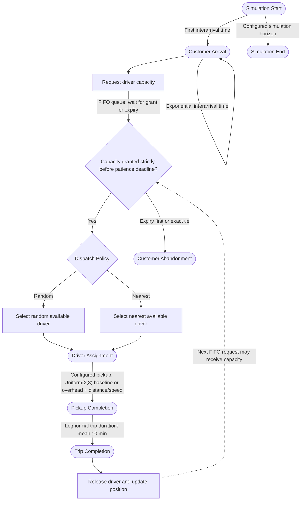

# Event Graph — Ride-Sharing Simulation

## 1. Overview

This event graph represents the current discrete-event simulation model, including FIFO customer scheduling, random and nearest driver selection, customer abandonment, pickup, and trip completion.

## 2. Event Graph

## 3. Event Descriptions

| Event | Description |
|---|---|
| Simulation Start | Initializes the simulation at time zero. |
| Customer Arrival | Generates a new customer request. |
| Driver Assignment | Assigns an available driver after a valid FIFO capacity grant. |
| Customer Abandonment | Occurs when customer patience expires before assignment or at an exact deadline tie. |
| Pickup Completion | Marks the end of pickup and the beginning of the trip. |
| Trip Completion | Marks the successful completion of the customer journey. |
| Simulation End | Records the final state at the configured simulation horizon. |

## 4. Dispatch Policies

- Random: Selects an available driver uniformly at random.
- Nearest: Selects the available driver with the minimum Euclidean distance to the customer pickup location.
- Equal-distance ties are resolved using the lowest driver ID.
- Both policies preserve FIFO customer scheduling.

## 5. Simulation Rules

- Customer interarrival times follow an exponential distribution with a default mean of 0.75 minutes.
- Customer patience follows an exponential distribution with a default mean of 5 minutes.
- Baseline pickup follows Uniform(2,8) minutes. The optional distance-aware mode
  uses overhead + assignment distance / speed and can be zero. It is an explicit
  experimental assumption; baseline sampling and trip distribution are preserved.
- Trip duration follows a lognormal distribution with an arithmetic mean of 10 minutes.
- A driver remains busy throughout pickup and trip.
- After trip completion, the driver becomes available at the customer's destination.
- Events scheduled exactly at the simulation horizon are excluded.
- Unfinished customers retain their current status at the simulation horizon.

## 6. Event History and Visualization

The customer event history records simulation start, arrival, driver assignment, abandonment, pickup completion, trip completion, and simulation end.

Driver assignment and release are also tracked separately in the driver history.

The visualization displays four customer status categories:

- Waiting
- Assigned (Pickup and On Trip)
- Completed
- Abandoned

Q(t) represents the number of waiting customers.

B(t) represents the number of busy drivers.

The engine supports driver IDs and abstract planar coordinates. However, the current 2D replay uses schematic positions and illustrative transition effects rather than actual geographical routes.

All durations and simulation parameters are configurable.
