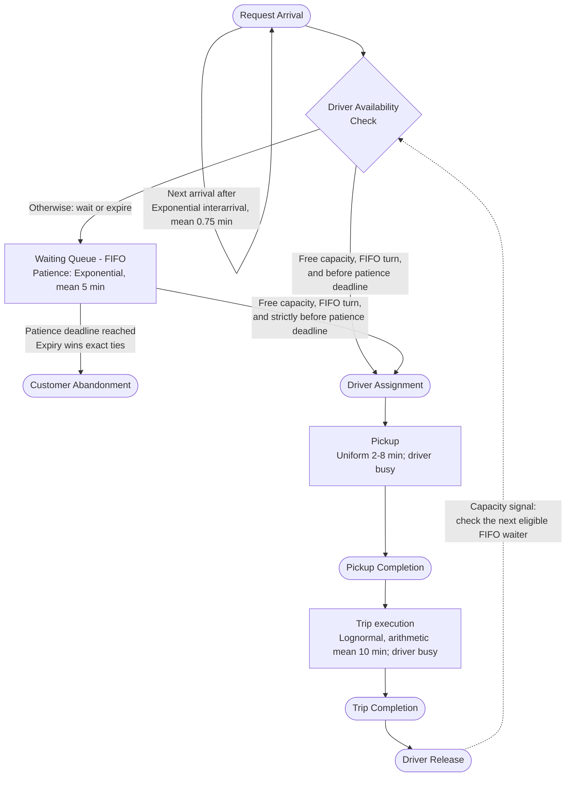

# Project 9: Ride-Sharing Dispatch in a City Zone

A university Modeling and Simulation with Python project. This repository contains
the core discrete-event simulation engine and its team integration data.
All simulation times are minutes. Steps 1-5 are complete; Week 2 adds CI,
reusable configurations, optional raw event export, and bounded reliability tests.

Requests arrive through a Poisson process. An anonymous SimPy driver Resource
serves customers in FIFO order, subject to exponential patience before assignment.
Assigned drivers remain occupied through uniform pickup and lognormal trip stages.

## Event Graph



Arrivals continue independently of customers already waiting or in service. Each
customer samples patience on arrival and either receives a free driver immediately
when eligible or waits in FIFO order. Abandonment applies only before assignment; reaching the
patience deadline wins an exact tie with driver availability. Assigned drivers
remain occupied through pickup and trip, then become available at trip completion.
The dashed link signals released capacity for the next FIFO waiter; a completed
customer leaves the system and never returns to the queue or abandons. The times
shown are configurable defaults, measured in minutes.

## Install and run (PowerShell)

Use Python 3.10 or newer. The checked environment is Python 3.14.7 and SimPy 4.1.2.
Run these commands from the project directory; activating the environment is optional.

```powershell
python -m venv .venv
.\.venv\Scripts\python.exe -m pip install -r requirements.txt
.\.venv\Scripts\python.exe main.py
.\.venv\Scripts\python.exe -B -m unittest discover -v
```

On macOS/Linux, use `.venv/bin/python` in place of the Windows executable path.
SimPy is the only external dependency; tests use the standard library.

## Continuous integration

`.github/workflows/python-tests.yml` runs unittest discovery on Python 3.14 for
Pull Requests targeting `main` and pushes to `main`. It installs `requirements.txt`
on a fresh Ubuntu runner. Test failures fail the job; no external keys or secrets
are required, and the workflow has only `contents: read` permission.

Open a Pull Request's **Checks** tab to see **Python tests / unittest**, or open
the repository's **Actions** tab and select **Python tests**. Expand the install
and test steps to inspect logs. A local passing run does not establish that a
GitHub-hosted run has passed. Run the same tests locally with:

```powershell
.\.venv\Scripts\python.exe -B -m unittest discover -v
```

See the official [workflow syntax](https://docs.github.com/en/actions/reference/workflows-and-actions/workflow-syntax)
and [Python setup action](https://github.com/actions/setup-python/tree/v6) for the
workflow format and runner setup. Repository owners must enable Actions if it has
been disabled; this change does not alter repository settings or branch protection.

## Use the engine

```python
from config import SimulationConfig
from simulation import RideSharingSimulation

simulation = RideSharingSimulation(SimulationConfig(fleet_size=20, random_seed=42))
simulation.run()  # Runs once to the exclusive configured horizon and validates results.
requests = simulation.requests
history = simulation.event_history
waiting_customers = simulation.waiting_requests
busy_drivers = simulation.busy_driver_count
```

Configuration is a frozen dataclass. Create a new configuration and simulation to
change settings or repeat a run. Each simulation owns its RNG streams; global
Python random state is unchanged. Full parameter and result definitions are in
[TEAM_HANDOFF.md](TEAM_HANDOFF.md).

## Reusable configurations

Reusable configurations are available through `scenarios.get_scenario(name,
**overrides)`. They return fresh, validated `SimulationConfig` objects without
running simulations. Explicit overrides take precedence; all other settings
(including seed 42 and the 60-minute horizon) retain the existing defaults.

| Preset | Difference from baseline |
| --- | --- |
| `baseline` | No changes: interarrival mean 0.75 minutes, fleet 20 |
| `low_demand` | Interarrival mean 1.5 minutes |
| `high_demand` | Interarrival mean 0.25 minutes |
| `small_fleet` | Fleet size 5 |
| `large_fleet` | Fleet size 40 |

These are illustrative configurations, not experimental results or calibrated
recommendations. Demand and fleet changes are separate; combine them explicitly
when needed. `main.py` continues to use the unchanged default configuration.

```python
from scenarios import get_scenario
from simulation import RideSharingSimulation

simulation = RideSharingSimulation(get_scenario("high_demand", random_seed=42))
simulation.run()
```

## Optional CSV export

```python
from event_export import export_event_history

export_event_history(simulation.event_history, "events.csv")
```

Normal runs create no CSV. The explicit exporter writes UTF-8 with a header and
all actual `SimulationEvent` fields: `sequence`, `time`, `event_type`, `request_id`,
`request_status`, `service_stage`, `arrivals`, `waiting` (Q), `in_system` (N),
`busy_drivers` (B), `completed`, and `abandoned`. Time is in minutes; missing
values are empty cells. Rows retain input order, including equal timestamps;
values are not rounded. Empty histories produce a header only. Choose any output
path whose parent already exists; an existing file is overwritten. Reopen using
`csv.DictReader`. Full field definitions are in [TEAM_HANDOFF.md](TEAM_HANDOFF.md).

## Files and verification

- `config.py`: validated parameters and the arithmetic-mean lognormal conversion.
- `scenarios.py`: five reusable presets and explicit validated overrides.
- `simulation.py`: arrival/customer processes, resources, records, immutable event
  snapshots, and automatic end-of-run invariant checks.
- `event_export.py`: opt-in serialization of raw event history, with no metrics.
- `main.py`: the existing command-line run, summary, and provisional calculations.
- `test_simulation.py`: the original 70 automated tests, unchanged.
- `test_scenarios.py`, `test_event_export.py`, `test_stress_simulation.py`: 21
  additional tests; unittest discovery runs 91 tests on this branch's baseline.
- `.github/workflows/python-tests.yml`: CI on PRs and main pushes.
- [PROJECT_REQUIREMENTS.md](PROJECT_REQUIREMENTS.md): scope and completion checklist.
- [TEAM_HANDOFF.md](TEAM_HANDOFF.md): integration contract, measurement definitions,
  consumer guidance, limitations, and proposed dispatch extension.

Default seed-42 output: 86 arrivals, 58 completed, 20 in service, 0 waiting, and 8
abandoned after 60 minutes. The engine validates conservation, lifecycle timing,
FIFO membership, driver ownership/capacity, and history consistency on each
successful `run()`. Invalid results raise `RuntimeError`; failed runs must be
discarded.

## Team scope

Person 1 owns core reliability, validation, configuration infrastructure, raw data
export, CI, and integration support. This change adds no metrics or visualization.

Person 2 owns `metrics.py`, `test_metrics.py`, queue delay, time in system,
time-average Q/N, utilization, statistical analysis, replications, confidence
intervals, and experiments. Person 3 owns Event Graph development, animation
technology research, 2D visualization, notebooks, and final presentation.

This branch starts from `main` at `95fda6d`. The existing CLI waiting-time
calculation is provisional and mixes assigned and abandoned waits. Its correction
is tracked separately in [PR #2](https://github.com/lilemiv/seng331-ridesharing-simulation/pull/2),
which was open at this branch's creation and is not included here. Review that PR
independently; this infrastructure has no dependency on it. Person 2 should use
the handoff's measurement definitions when developing the statistics module.

Resource slots remain anonymous: there are no driver IDs, coordinates, routes,
or dispatch policies. Event history supports schematic replay; location-based
animation needs a future agreed model, proposed in handoff section 8. No such
extension is implemented. History grows with events, so stress tests are bounded
(the longest horizon is 1440 simulated minutes). CSV exports contain raw data only.
