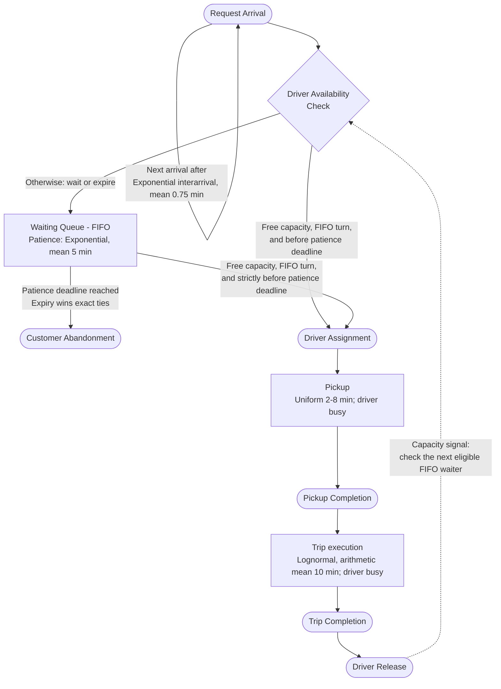

# Core Simulation Team Handoff

## 1. Setup, execution, and tests

Use Python 3.10+ and run the following from the repository directory in PowerShell:

```powershell
python -m venv .venv
.\.venv\Scripts\python.exe -m pip install -r requirements.txt
.\.venv\Scripts\python.exe main.py
.\.venv\Scripts\python.exe -m unittest -v
```

The verified environment uses Python 3.14.7 and SimPy 4.1.2. Requirements permit
SimPy 4.1.x and later 4.x versions; retain the verified versions when reproducing
the handoff output. On macOS/Linux, use `.venv/bin/python`. No test runner package
or graphical environment is needed. Do not copy another member's `.venv` directory.

## 2. Configuration

Create a fresh immutable `SimulationConfig` and engine for every independent run.
All durations and time limits are in minutes.

| Setting | Default | Meaning / constraint |
| --- | --- | --- |
| `mean_interarrival_minutes` | `0.75` | Positive finite exponential mean (45 seconds) |
| `duration_minutes` | `60.0` | Positive finite exclusive simulation horizon |
| `random_seed` | `42` | Integer seed; booleans are rejected |
| `fleet_size` | `20` | Positive integer number of anonymous drivers |
| `mean_patience_minutes` | `5.0` | Exponential mean, inclusive range 3-8 |
| `pickup_min_minutes` | `2.0` | Positive finite uniform lower bound |
| `pickup_max_minutes` | `8.0` | Finite upper bound, at least the lower bound |
| `trip_mean_minutes` | `10.0` | Positive finite arithmetic trip mean |
| `trip_sigma` | `0.5` | Finite nonnegative log-scale standard deviation |

`trip_mu` is derived as `log(trip_mean_minutes) - trip_sigma^2 / 2`. The sampler
uses `exp(Normal(mu, sigma^2))`, whose arithmetic mean is
`exp(mu + sigma^2 / 2)`. Do not pass the desired arithmetic mean as `mu`.
The default mu is approximately 2.177585. Sigma zero is a deterministic limiting
case. Pickup bounds may be equal. Individual patience samples can be outside 3-8.

The four local RNGs use `abs(random_seed) + offset`, where offsets 0, 1, 2, and 3
belong to arrivals, patience, pickup, and trips. Negative seeds normalize to their
absolute value, matching Python's integer seeding behavior. All four streams stay
distinct. New service samples never consume arrival or patience randomness.
Pickup is sampled at assignment; trip duration is sampled when the trip starts.
Different parameters can change who receives service even when arrivals and
patience samples remain identical.

## 3. Stable integration interface

```python
from dataclasses import asdict
from config import SimulationConfig
from simulation import RideSharingSimulation

config = SimulationConfig(fleet_size=20, duration_minutes=60, random_seed=42)
sim = RideSharingSimulation(config)
sim.run()

request_rows = [asdict(request) for request in sim.requests]
event_rows = [asdict(event) for event in sim.event_history]
fifo_customers = sim.waiting_requests  # Tuple of RideRequest objects in actual FIFO order.
busy_count = sim.busy_driver_count
actual_duration = sim.env.now
fleet_size = sim.config.fleet_size
```

These examples access raw data only; they do not compute statistical results.
`run()` is intended to be called once per instance. It ends at `duration_minutes`,
records a boundary snapshot, then calls `validate_invariants()`. That method can
also be called at a settled run boundary; it raises `RuntimeError` on invalid
results. It is not a synchronization mechanism for arbitrary internal `env.step()`
points. A Resource grant and its customer's callback can be separate internal
events at the same simulation time.

`requests` is the complete arrival ledger in sequential ID order, including all
abandoned and unfinished customers. Treat the list and its mutable records as
read-only. `waiting_requests` is a tuple snapshot of current FIFO membership;
its contained customer records are the same engine-owned objects. The underlying
`driver_pool.queue` contains SimPy request events, not customer records.
`busy_driver_count` exposes occupied Resource slots. The existing `driver_pool`,
`env`, `config`, `requests`, and timestamp fields remain available.

## 4. Lifecycle and request records

```text
waiting -> in_service (pickup -> trip) -> completed
waiting -> abandoned
```

Pickup represents the assigned driver traveling to the customer. Pickup completion
is the customer's boarding/trip start. No route or coordinates are modeled yet.
A driver is occupied continuously from assignment through trip completion.
Patience applies only before assignment; exact assignment/expiry ties favor expiry.

### Event Graph



This is the same corrected lifecycle graph shown in [README.md](README.md#event-graph).
Assignment requires free capacity, FIFO eligibility, and an unexpired patience
deadline. Drivers stay busy throughout pickup and trip. The dashed return link
signals released capacity for another waiting customer, not a completed
customer returning to the queue.

| Record member | Meaning |
| --- | --- |
| `request_id` | Unique sequential integer starting at 1 |
| `arrival_time` | Customer enters the system |
| `patience_time` | Sampled allowance, measured from arrival |
| `service_start_time` | Driver assignment, preserved from previous steps |
| `driver_assignment_time` | Read-only alias of `service_start_time` |
| `pickup_start_time` | Driver starts pickup; equal to assignment time |
| `pickup_completion_time` | Driver reaches customer; pickup ends |
| `trip_start_time` | Customer trip starts; equal to pickup completion |
| `completion_time` | Customer trip ends; preserved from previous steps |
| `trip_completion_time` | Read-only alias of `completion_time` |
| `pickup_duration`, `trip_duration` | Sampled duration, available once that stage starts |
| `abandonment_time` | Customer leaves before assignment |
| `status` | Current waiting/in_service/completed/abandoned state |
| `service_stage` | Read-only current pickup/trip stage, otherwise `None` |

All timestamps are relative to simulation start, in minutes. `None` means an event
has not occurred. Zero is a valid timestamp. A sampled duration is not evidence of
completion. `asdict()` includes stored fields; aliases and `service_stage` must
be accessed separately if consumers want those named columns.

Events at exactly the horizon are excluded. Thus an unfinished pickup has no
pickup completion or trip start; an unfinished trip has no trip completion. The
driver is still busy at the boundary. A waiting customer's deadline can equal the
horizon without abandonment being processed. Unfinished requests are censored,
not completed or abandoned. The engine does not drain customers after the horizon.

## 5. Immutable event history

`sim.event_history` is a list of frozen `SimulationEvent` dataclass snapshots.
Treat the list itself as read-only. Rows do not hold live customer references.

| Column | Meaning |
| --- | --- |
| `sequence` | Zero-based total order, including events at the same time |
| `time` | Simulation timestamp, in minutes |
| `event_type` | Lifecycle event or simulation boundary marker |
| `request_id` | Affected customer ID, or `None` for boundary markers |
| `request_status` | That customer's state immediately after the event |
| `service_stage` | That customer's stage immediately after the event |
| `arrivals` | Cumulative number of arrivals |
| `waiting` | Q: customers awaiting driver assignment |
| `in_system` | N: customers waiting or in service |
| `busy_drivers` | B: logically assigned drivers, including pickup and trip |
| `completed`, `abandoned` | Cumulative terminal customer counts |

Event types are `simulation_start`, `arrival`, `driver_assignment`, `abandonment`,
`pickup_completion`, `trip_completion`, and `simulation_end`. Boundary markers
have no request ID/status/stage. The start row is at time zero with zero counts;
the end row is at the horizon with unchanged final counts. The end marker does
not process lifecycle events excluded by the horizon.

Each row describes the logical state after its named transition. For example,
assignment decreases Q and increases B; pickup completion changes stage but keeps
Q, N, and B unchanged; abandonment decreases Q and N; trip completion decreases N
and B. Every row conserves arrivals as waiting + busy + completed + abandoned.

Several rows can share one timestamp. Preserve `sequence`; do not reorder equal
times by event type or customer ID. An immediate-service arrival has a waiting
row followed by assignment at the same time. For a right-continuous Q/N/B trace,
use the last row at a timestamp as the state until the next distinct timestamp.
Earlier rows at that same time have zero elapsed duration. This also removes
transient SimPy grant/callback differences from duration-based measurements.

The only events produced for an abandoned customer are arrival and abandonment.
The history contains no extra event for a patience timer firing after assignment.
All time boundaries needed to reconstruct occupancy are supplied, including for
empty runs and services unfinished at the horizon.

## 6. Instructions for the statistics developer

Use the following definitions consistently. These are measurement specifications;
metric functions, replications, comparisons, and statistical analysis are not
implemented in this repository.

| Quantity | Definition and population |
| --- | --- |
| Queue delay until assignment | Assignment minus arrival, for assigned customers |
| Time until pickup begins | Pickup start minus arrival; equals queue delay in this model |
| Customer waiting until vehicle arrives | Pickup completion minus arrival; includes queue delay and driver travel to the customer |
| Pickup travel duration | Pickup completion minus pickup start |
| Trip duration | Trip completion minus trip start |
| Completed customer's time in system | Trip completion minus arrival |
| Abandoned customer's time in system | Abandonment minus arrival; report separately from completed journeys |
| Driver busy interval | Assignment through trip completion, covering pickup and trip, excluding queue delay |

For unfinished requests, mark missing outcomes as censored. Do not substitute zero
for missing timestamps or mix completed-only averages with censored outcomes
without choosing and stating an appropriate method. For within-run exposure only,
clip an unfinished waiting/busy/system interval at the actual horizon.

For time-average queue length and system population, accumulate each history
state's Q or N over the elapsed interval for which it holds, ending at the horizon,
then normalize by observation duration. Fleet utilization uses the corresponding
B exposure normalized by fleet size and observation duration. This is time
weighting, not an unweighted average of event rows. Use the initial/final markers
and the same-time convention above; include unfinished exposure through the end.
Per-driver utilization is unavailable without individual driver identities.

Throughput uses completed trips over observation time. For customer outcomes,
distinguish completion fraction, assignment fraction, abandonment fraction, and
the still-waiting/in-service fractions at the finite horizon; assignment and
completion are different outcomes. Choose an explicit denominator for each.
Do not infer steady-state results from one short debugging run. Seeds, warm-up,
replications, uncertainty analysis, and experiment designs belong to your work.

## 7. Instructions for the animation and notebook developer

Import the engine as shown above; importing `main.py` does not launch a run.
Use request IDs as stable customer keys and `event_history` sequence/time to replay
lifecycle changes. Use timestamps for past stages; final `status`/`service_stage`
alone do not represent earlier animation frames. Sampled stage durations allow
progress within a stage, but do not invent an observed completion beyond the run
horizon. Keep the final frame consistent with unfinished and abandoned customers.

There are no geographic coordinates, individual driver identities, routes, frame
callbacks, plotting, notebooks, or animation implementation. Any schematic layout
must be labeled as such. Geographic animation requires the future agreed location
model. Keep notebook organization and presentation logic outside this engine.
The final Event Graph documentation remains your group's separate deliverable.

## 8. Proposed random/nearest dispatch extension (not implemented)

The instructor's random-versus-nearest comparison is still outstanding. Anonymous
Resource slots cannot distinguish drivers. Agree ownership and location semantics
before extending the engine; the present Resource remains unchanged.

1. Introduce individual driver records: stable ID, availability, current location,
   and assigned request ID. Define initial fleet locations and coordinate/distance
   units. Add pickup locations and, if vehicles move after trips, trip destinations
   to request data using independent location RNG streams.
2. Keep Resource as the FIFO capacity gate. After a customer wins acquisition
   before its deadline, choose a free driver and mark it occupied atomically,
   without yielding between token acquisition and reservation. Maintain a one-to-one
   invariant between held slots and reserved driver records. Avoid adding a second
   independent waiting queue that can conflict with FIFO ordering.
3. Isolate selection behind a policy interface such as
   `select_driver(request, available_drivers, policy_rng)`. Random selection draws
   from a stable ID-sorted available set with its own RNG. Nearest selection uses
   the agreed distance function and driver ID as a deterministic distance tie-break.
4. Record the assigned driver ID and position changes for later consumers. At trip
   completion update location, return the driver to the available set, then release
   the Resource token without an intervening yield. Cancellation and exact deadline
   ties must reserve no individual driver, or undo any reservation atomically.
5. Agree whether pickup/trip durations stay sampled independently or depend on
   distance/speed. Euclidean distance, road-network distance, and routing are
   different models; this handoff chooses none of them.
6. Add policy/unit/integration tests for unique reservation, driver-location updates,
   tie-breaking, seed isolation, resource consistency, and cancellation. The other
   members' experiment code can then compare policies using a common scenario
   definition and controlled randomness. Do not equate same seeds with matching
   per-customer service draws when policies change the order stages begin.

## 9. Known limitations and checks

`run()` performs conservation, lifecycle, FIFO membership, occupied-slot, and raw
history checks on successful completion. It does not calculate performance metrics.
Tests cover normal/high demand, small/large fleets, abandonment-heavy demand,
simultaneous events, empty runs, horizons, reproducibility, and immutable history.

Resource slots are anonymous; there is no spatial model, advanced policy, or
per-driver trace. History storage grows with lifecycle events. Both output lists
are engine-owned mutable containers and must not be changed by consumers. Extreme
trip parameters that overflow/underflow floating-point sampling raise `ValueError`;
invariant violations raise `RuntimeError`. Discard failed runs and fix their input
or cause rather than continuing from partial records. Configuration type hints
describe intended inputs; only the documented numerical/seed/fleet checks are
enforced, so do not pass arbitrary nonnumeric objects.

## 10. Remaining group deliverables

The core implementation and raw integration data end at Step 5. Remaining work is
statistics/metrics, Q/N/B plots, replications, confidence intervals, beta analysis,
experimental comparisons (including random versus nearest dispatch), Event Graph,
notebooks, 2D animation, final report, and presentation. Policy/location engine
changes are a future agreed extension, not implemented as part of this handoff.
