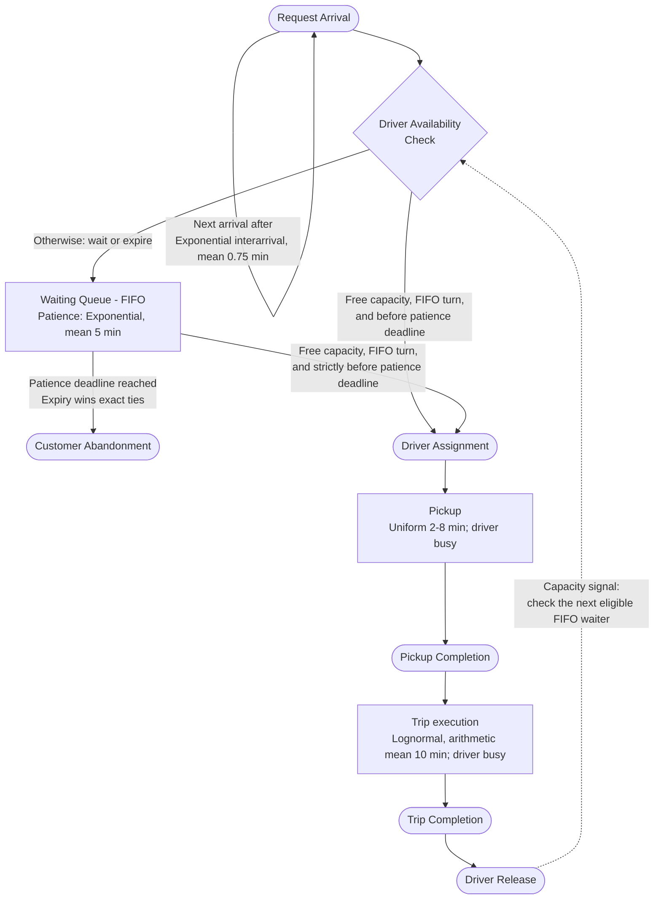

# Core Simulation Team Handoff

## 1. Setup, execution, and tests

Use Python 3.10+ and run the following from the repository directory in PowerShell:

```powershell
python -m venv .venv
.\.venv\Scripts\python.exe -m pip install -r requirements.txt
.\.venv\Scripts\python.exe main.py
.\.venv\Scripts\python.exe -B -m unittest discover -v
```

The verified environment uses Python 3.14.7 and SimPy 4.1.2. Requirements permit
SimPy 4.1.x and later 4.x versions; retain the verified versions when reproducing
the handoff output. On macOS/Linux, use `.venv/bin/python`. No test runner package
or graphical environment is needed. Do not copy another member's `.venv` directory.

## 2. Configuration

Create a fresh immutable `SimulationConfig` and engine for every independent run.
All durations and time limits are in minutes.

| Setting | Default | Meaning / constraint |
| --- | --- | --- |
| `mean_interarrival_minutes` | `0.75` | Positive finite exponential mean (45 seconds) |
| `duration_minutes` | `60.0` | Positive finite exclusive simulation horizon |
| `random_seed` | `42` | Integer seed; booleans are rejected |
| `fleet_size` | `20` | Positive integer number of anonymous drivers |
| `mean_patience_minutes` | `5.0` | Exponential mean, inclusive range 3-8 |
| `pickup_min_minutes` | `2.0` | Positive finite uniform lower bound |
| `pickup_max_minutes` | `8.0` | Finite upper bound, at least the lower bound |
| `trip_mean_minutes` | `10.0` | Positive finite arithmetic trip mean |
| `trip_sigma` | `0.5` | Finite nonnegative log-scale standard deviation |

`trip_mu` is derived as `log(trip_mean_minutes) - trip_sigma^2 / 2`. The sampler
uses `exp(Normal(mu, sigma^2))`, whose arithmetic mean is
`exp(mu + sigma^2 / 2)`. Do not pass the desired arithmetic mean as `mu`.
The default mu is approximately 2.177585. Sigma zero is a deterministic limiting
case. Pickup bounds may be equal. Individual patience samples can be outside 3-8.

The four local RNGs use `abs(random_seed) + offset`, where offsets 0, 1, 2, and 3
belong to arrivals, patience, pickup, and trips. Negative seeds normalize to their
absolute value, matching Python's integer seeding behavior. All four streams stay
distinct. New service samples never consume arrival or patience randomness.
Pickup is sampled at assignment; trip duration is sampled when the trip starts.
Different parameters can change who receives service even when arrivals and
patience samples remain identical.

## 3. Stable integration interface

```python
from dataclasses import asdict
from config import SimulationConfig
from simulation import RideSharingSimulation

config = SimulationConfig(fleet_size=20, duration_minutes=60, random_seed=42)
sim = RideSharingSimulation(config)
sim.run()

request_rows = [asdict(request) for request in sim.requests]
event_rows = [asdict(event) for event in sim.event_history]
fifo_customers = sim.waiting_requests  # Tuple of RideRequest objects in actual FIFO order.
busy_count = sim.busy_driver_count
actual_duration = sim.env.now
fleet_size = sim.config.fleet_size
```

These examples access raw data only; they do not compute statistical results.
`run()` is intended to be called once per instance. It ends at `duration_minutes`,
records a boundary snapshot, then calls `validate_invariants()`. That method can
also be called at a settled run boundary; it raises `RuntimeError` on invalid
results. It is not a synchronization mechanism for arbitrary internal `env.step()`
points. A Resource grant and its customer's callback can be separate internal
events at the same simulation time.

`requests` is the complete arrival ledger in sequential ID order, including all
abandoned and unfinished customers. Treat the list and its mutable records as
read-only. `waiting_requests` is a tuple snapshot of current FIFO membership;
its contained customer records are the same engine-owned objects. The underlying
`driver_pool.queue` contains SimPy request events, not customer records.
`busy_driver_count` exposes occupied Resource slots. The existing `driver_pool`,
`env`, `config`, `requests`, and timestamp fields remain available.

## 4. Lifecycle and request records

```text
waiting -> in_service (pickup -> trip) -> completed
waiting -> abandoned
```

Pickup represents the assigned driver traveling to the customer. Pickup completion
is the customer's boarding/trip start. No route or coordinates are modeled yet.
A driver is occupied continuously from assignment through trip completion.
Patience applies only before assignment; exact assignment/expiry ties favor expiry.

### Event Graph



This is the same corrected lifecycle graph shown in [README.md](README.md#event-graph).
Assignment requires free capacity, FIFO eligibility, and an unexpired patience
deadline. Drivers stay busy throughout pickup and trip. The dashed return link
signals released capacity for another waiting customer, not a completed
customer returning to the queue.

| Record member | Meaning |
| --- | --- |
| `request_id` | Unique sequential integer starting at 1 |
| `arrival_time` | Customer enters the system |
| `patience_time` | Sampled allowance, measured from arrival |
| `service_start_time` | Driver assignment, preserved from previous steps |
| `driver_assignment_time` | Read-only alias of `service_start_time` |
| `pickup_start_time` | Driver starts pickup; equal to assignment time |
| `pickup_completion_time` | Driver reaches customer; pickup ends |
| `trip_start_time` | Customer trip starts; equal to pickup completion |
| `completion_time` | Customer trip ends; preserved from previous steps |
| `trip_completion_time` | Read-only alias of `completion_time` |
| `pickup_duration`, `trip_duration` | Sampled duration, available once that stage starts |
| `abandonment_time` | Customer leaves before assignment |
| `status` | Current waiting/in_service/completed/abandoned state |
| `service_stage` | Read-only current pickup/trip stage, otherwise `None` |

All timestamps are relative to simulation start, in minutes. `None` means an event
has not occurred. Zero is a valid timestamp. A sampled duration is not evidence of
completion. `asdict()` includes stored fields; aliases and `service_stage` must
be accessed separately if consumers want those named columns.

Events at exactly the horizon are excluded. Thus an unfinished pickup has no
pickup completion or trip start; an unfinished trip has no trip completion. The
driver is still busy at the boundary. A waiting customer's deadline can equal the
horizon without abandonment being processed. Unfinished requests are censored,
not completed or abandoned. The engine does not drain customers after the horizon.

## 5. Immutable event history

`sim.event_history` is a list of frozen `SimulationEvent` dataclass snapshots.
Treat the list itself as read-only. Rows do not hold live customer references.

| Column | Meaning |
| --- | --- |
| `sequence` | Zero-based total order, including events at the same time |
| `time` | Simulation timestamp, in minutes |
| `event_type` | Lifecycle event or simulation boundary marker |
| `request_id` | Affected customer ID, or `None` for boundary markers |
| `request_status` | That customer's state immediately after the event |
| `service_stage` | That customer's stage immediately after the event |
| `arrivals` | Cumulative number of arrivals |
| `waiting` | Q: customers awaiting driver assignment |
| `in_system` | N: customers waiting or in service |
| `busy_drivers` | B: logically assigned drivers, including pickup and trip |
| `completed`, `abandoned` | Cumulative terminal customer counts |

Event types are `simulation_start`, `arrival`, `driver_assignment`, `abandonment`,
`pickup_completion`, `trip_completion`, and `simulation_end`. Boundary markers
have no request ID/status/stage. The start row is at time zero with zero counts;
the end row is at the horizon with unchanged final counts. The end marker does
not process lifecycle events excluded by the horizon.

Each row describes the logical state after its named transition. For example,
assignment decreases Q and increases B; pickup completion changes stage but keeps
Q, N, and B unchanged; abandonment decreases Q and N; trip completion decreases N
and B. Every row conserves arrivals as waiting + busy + completed + abandoned.

Several rows can share one timestamp. Preserve `sequence`; do not reorder equal
times by event type or customer ID. An immediate-service arrival has a waiting
row followed by assignment at the same time. For a right-continuous Q/N/B trace,
use the last row at a timestamp as the state until the next distinct timestamp.
Earlier rows at that same time have zero elapsed duration. This also removes
transient SimPy grant/callback differences from duration-based measurements.

The only events produced for an abandoned customer are arrival and abandonment.
The history contains no extra event for a patience timer firing after assignment.
All time boundaries needed to reconstruct occupancy are supplied, including for
empty runs and services unfinished at the horizon.

## 6. Instructions for the statistics developer

Use the following definitions consistently. Person 2's Week 2 implementation is
now in `metrics.py`; section 13 documents its API and verification. Replications,
comparisons, and uncertainty analysis remain future work. The Week 1 CLI
correction and core infrastructure are already merged into the current baseline.

| Quantity | Definition and population |
| --- | --- |
| Queue delay until assignment | Assignment minus arrival, for assigned customers |
| Time until pickup begins | Pickup start minus arrival; equals queue delay in this model |
| Customer waiting until vehicle arrives | Pickup completion minus arrival; includes queue delay and driver travel to the customer |
| Pickup travel duration | Pickup completion minus pickup start |
| Trip duration | Trip completion minus trip start |
| Completed customer's time in system | Trip completion minus arrival |
| Abandoned customer's time in system | Abandonment minus arrival; report separately from completed journeys |
| Driver busy interval | Assignment through trip completion, covering pickup and trip, excluding queue delay |

For unfinished requests, mark missing outcomes as censored. Do not substitute zero
for missing timestamps or mix completed-only averages with censored outcomes
without choosing and stating an appropriate method. For within-run exposure only,
clip an unfinished waiting/busy/system interval at the actual horizon.

For time-average queue length and system population, accumulate each history
state's Q or N over the elapsed interval for which it holds, ending at the horizon,
then normalize by observation duration. Fleet utilization uses the corresponding
B exposure normalized by fleet size and observation duration. This is time
weighting, not an unweighted average of event rows. Use the initial/final markers
and the same-time convention above; include unfinished exposure through the end.
Per-driver utilization is unavailable without individual driver identities.

Throughput uses completed trips over observation time. For customer outcomes,
distinguish completion fraction, assignment fraction, abandonment fraction, and
the still-waiting/in-service fractions at the finite horizon; assignment and
completion are different outcomes. Choose an explicit denominator for each.
Do not infer steady-state results from one short debugging run. Seeds, warm-up,
replications, uncertainty analysis, and experiment designs belong to your work.

## 7. Instructions for the animation and notebook developer

Import the engine as shown above; importing `main.py` does not launch a run.
Use request IDs as stable customer keys and `event_history` sequence/time to replay
lifecycle changes. Use timestamps for past stages; final `status`/`service_stage`
alone do not represent earlier animation frames. Sampled stage durations allow
progress within a stage, but do not invent an observed completion beyond the run
horizon. Keep the final frame consistent with unfinished and abandoned customers.

There are no geographic coordinates, individual driver identities, routes, frame
callbacks, plotting, notebooks, or animation implementation. Any schematic layout
must be labeled as such. Geographic animation requires the future agreed location
model. Keep notebook organization and presentation logic outside this engine.
The final Event Graph documentation remains your group's separate deliverable.

## 8. Proposed random/nearest dispatch extension (not implemented)

The instructor's random-versus-nearest comparison is still outstanding. Anonymous
Resource slots cannot distinguish drivers. Agree ownership and location semantics
before extending the engine; the present Resource remains unchanged.

1. Introduce individual driver records: stable ID, availability, current location,
   and assigned request ID. Define initial fleet locations and coordinate/distance
   units. Add pickup locations and, if vehicles move after trips, trip destinations
   to request data using independent location RNG streams.
2. Keep Resource as the FIFO capacity gate. After a customer wins acquisition
   before its deadline, choose a free driver and mark it occupied atomically,
   without yielding between token acquisition and reservation. Maintain a one-to-one
   invariant between held slots and reserved driver records. Avoid adding a second
   independent waiting queue that can conflict with FIFO ordering.
3. Isolate selection behind a policy interface such as
   `select_driver(request, available_drivers, policy_rng)`. Random selection draws
   from a stable ID-sorted available set with its own RNG. Nearest selection uses
   the agreed distance function and driver ID as a deterministic distance tie-break.
4. Record the assigned driver ID and position changes for later consumers. At trip
   completion update location, return the driver to the available set, then release
   the Resource token without an intervening yield. Cancellation and exact deadline
   ties must reserve no individual driver, or undo any reservation atomically.
5. Agree whether pickup/trip durations stay sampled independently or depend on
   distance/speed. Euclidean distance, road-network distance, and routing are
   different models; this handoff chooses none of them.
6. Add policy/unit/integration tests for unique reservation, driver-location updates,
   tie-breaking, seed isolation, resource consistency, and cancellation. The other
   members' experiment code can then compare policies using a common scenario
   definition and controlled randomness. Do not equate same seeds with matching
   per-customer service draws when policies change the order stages begin.

## 9. Known limitations and checks

`run()` performs conservation, lifecycle, FIFO membership, occupied-slot, and raw
history checks on successful completion. It does not calculate performance metrics.
Tests cover normal/high demand, small/large fleets, abandonment-heavy demand,
simultaneous events, empty runs, horizons, reproducibility, and immutable history.

Resource slots are anonymous; there is no spatial model, advanced policy, or
per-driver trace. History storage grows with lifecycle events. Both output lists
are engine-owned mutable containers and must not be changed by consumers. Extreme
trip parameters that overflow/underflow floating-point sampling raise `ValueError`;
invariant violations raise `RuntimeError`. Discard failed runs and fix their input
or cause rather than continuing from partial records. Configuration type hints
describe intended inputs; only the documented numerical/seed/fleet checks are
enforced, so do not pass arbitrary nonnumeric objects.

## 10. Remaining group deliverables

Steps 1-5 provide the completed engine and raw integration data. Person 1's Week 2
infrastructure adds CI, presets, CSV export, and reliability coverage (section 12).

Person 2's Week 2 `metrics.py`, `test_metrics.py`, queue delay, completed-customer
system time, time-average Q/N, and pooled utilization are implemented (section 13).
Statistical analysis, replications, warm-up, confidence intervals, beta analysis,
and experiments remain future work. These are not missing Week 1 deliverables.

Person 3 owns Event Graph development, Matplotlib/Pygame research, the initial 2D
prototype, event-history visualization integration, notebooks, and presentation.
The existing Event Graph is preserved. This infrastructure performs none of that
research or implementation. Final report coordination and the future instructor
dispatch comparison remain group responsibilities. Driver/location/policy changes
require a separate agreed scope.

## 11. Week 2 integration compatibility review

No additional engine interface is required for the current statistics or event
replay work. The existing contract supports both direct Python consumption and
optional raw event CSV export; no statistics or visualization is computed here.

| Consumer | Existing data | Access |
| --- | --- | --- |
| Person 2 | Lifecycle timestamps, terminal and unfinished states | `sim.requests`: `arrival_time`, `driver_assignment_time`, pickup/trip timestamps, `abandonment_time`, `status`, `service_stage` |
| Person 2 | Q, N, B and cumulative customer counts | `sim.event_history`: `waiting`, `in_system`, `busy_drivers`, `arrivals`, `completed`, `abandoned` |
| Person 2 | Run horizon, fleet, distribution parameters and seed | `sim.config`, `sim.env.now`; presets from `scenarios.get_scenario` |
| Person 3 | Event ordering, timing, customer keys and transitions | `sim.event_history`: `sequence`, `time`, `event_type`, `request_id`, `request_status`, `service_stage` |

Consume data after `run()` returns successfully; treat engine-owned containers
and request records as read-only. Preserve equal-time sequence order and the
exclusive horizon. Missing timestamps remain censored outcomes. CSV is a serialized
snapshot, not a new source of lifecycle events or derived measurements.

The current interface supports schematic event replay. It cannot support actual
location-based vehicle motion because there are no driver identities, coordinates,
routes, or destinations. Section 8 proposes an agreed future driver/location
extension with independent random streams and atomic driver reservation/release.
That proposal remains unimplemented; no dispatch policy is selected here.

## 12. Week 2 core infrastructure

### Baseline, checks, and CI

Historical infrastructure delivery: its baseline was `main` commit `95fda6d`.
PR #2 (the assigned-customer CLI queue-delay fix and its three tests) was open at
that branch's creation and was not merged or copied into the infrastructure PR.
Its provisional `main.py` calculation retained that limitation until PR #2 was
reviewed separately. That infrastructure work changed no engine, configuration
default, original test, or teammate-owned deliverable. Both PRs are now merged;
section 13 describes the current statistics baseline.

Run `.\.venv\Scripts\python.exe -B -m unittest discover -v` (or
`.venv/bin/python -B -m unittest discover -v` on macOS/Linux). This baseline has
91 tests: 70 unchanged core tests, 6 preset tests, 6 CSV tests, and 9 bounded stress
tests. The one-day simulation is simulated time, not a real-time wait. All code
added here uses the standard library; SimPy remains the only runtime dependency.

`.github/workflows/python-tests.yml` runs the same discovery command on Python
3.14 and Ubuntu after installing `requirements.txt`. Triggers are PRs targeting
`main` and pushes to `main`; permissions are `contents: read`, with no external
API keys. Failed tests fail CI. View a PR's **Checks** tab or **Actions > Python
tests**, then open the `unittest` job's logs. Local results and actual hosted CI
results must be reported separately. Enabling Actions and requiring status checks
are repository-owner settings, not changes made by this branch.

### Configuration reuse

```python
from scenarios import SCENARIO_NAMES, get_scenario
from simulation import RideSharingSimulation

config = get_scenario("high_demand", fleet_size=5, random_seed=42)
sim = RideSharingSimulation(config)
sim.run()
```

`SCENARIO_NAMES` lists `baseline`, `low_demand`, `high_demand`, `small_fleet`, and
`large_fleet`. Baseline equals `SimulationConfig()`: mean interarrival 0.75 minutes,
20 drivers. Low/high demand change only that mean to 1.5/0.25 minutes; small/large
fleet change only capacity to 5/40. These are illustrative inputs, not experiments.
Each call returns a fresh frozen config using the existing dataclass validation.
Explicit overrides win; seed, 60-minute horizon, and every unspecified setting
retain their defaults. Unknown scenario names raise `ValueError`; invalid fields
or values follow dataclass errors/validation. There is no experiment runner.

### Optional CSV snapshot

```python
from event_export import export_event_history

export_event_history(sim.event_history, "events.csv")
```

The exporter accepts an iterable of actual `SimulationEvent` records and a string
or path object. It writes UTF-8 using Python's standard `csv` module, does not run
or mutate the simulation, and is never called automatically. Choose an existing
parent directory; existing output files are overwritten and I/O errors propagate.
An empty iterable writes only the header. A zero-arrival simulation still exports
its initial and final boundary markers.

Columns, in order, are:

```text
sequence,time,event_type,request_id,request_status,service_stage,arrivals,waiting,in_system,busy_drivers,completed,abandoned
```

Every column is the identically named field defined in section 5. `waiting` is Q,
`in_system` is N, and `busy_drivers` is B. Counts are logical state after each
event; `time` is simulation minutes. Missing request IDs/statuses/stages become
empty cells, not zero. Numbers are not rounded. Rows preserve supplied order,
including equal-time events; the exporter does not sort or invent observations.

Reopen with `csv.DictReader`; CSV cells are strings. Convert `sequence`, nonempty
`request_id`, and count fields to integers, and `time` to float. Use the last row
at a timestamp for the state until the next distinct timestamp. No metrics,
plots, animation frames, driver identities, or locations are added by export.

## 13. Week 2 Person 2 statistics delivery

### Baseline and API

The statistics branch starts at `main` commit `100696b`, with PRs #2 and #3
already merged. No open infrastructure PR was merged or copied. All 99 tests on
that current baseline pass unchanged. Calculations were moved out of `main.py`
into `metrics.py`, reusing the correct Week 1 assignment-delay definition.
`main.calculate_simulation_metrics(requests)` remains an importable alias of
`metrics.calculate_simulation_metrics`, preserving both legacy dictionary keys
and their units. It returns full precision; only the CLI formats numbers.

```python
from metrics import (
    average_queue_delay, average_time_in_system, time_average_queue_length,
    time_average_number_in_system, driver_utilization, abandonment_rate,
)

# sim has completed run() successfully; use its ledger at this same horizon.
delay = average_queue_delay(sim.requests)
system_time = average_time_in_system(sim.requests)
T = sim.env.now
q = time_average_queue_length(sim.event_history, T)
n = time_average_number_in_system(sim.event_history, T)
u = driver_utilization(sim.event_history, T, sim.config.fleet_size)
a = abandonment_rate(sim.requests)
print(delay.mean, delay.count, system_time.mean, system_time.count)
print(f"Driver utilization: {u:.2%}; abandonment: {a:.2%}")
```

Each public metric accepts an iterable of actual engine records. Materialize a
one-shot iterator before reusing it across calls. Request averages assume a valid
ledger at the observation horizon; they do not reconstruct earlier outcomes from
a later ledger. Neither request records, history order, resource state, nor random
streams are mutated. No additional dependencies are needed.

### Populations and denominators

| Metric | Numerator | Denominator / population |
| --- | --- | --- |
| Queue delay | Sum of assignment minus arrival | Assigned count, including completed and active pickup/trip; excludes abandoned and waiting |
| Completed time in system | Sum of completion minus arrival | Completed count only; excludes abandoned and unfinished pickup/trip/waiting |
| Time-average queue length | Integral of engine `waiting` Q(t) | Observation duration T |
| Time-average number in system | Integral of engine `in_system` N(t) | T; N includes waiting and assigned pickup/trip, excludes departures |
| Pooled driver utilization | Integral of engine `busy_drivers` B(t) | Configured fleet_size * T; includes pickup and trip |
| Abandonment rate | Abandoned count | All arrivals, including unfinished arrivals |

Customer means return frozen `SampleMean(mean, count)`, with no rounding. Empty
populations return `SampleMean(0.0, 0)`; the zero mean does not indicate an observed
zero-duration customer. Abandonment residence is abandonment minus arrival and is
distinct from completed-trip system time; no separate residence mean is exposed
in this version. Unfinished requests are censored and excluded from the primary
completed-customer mean, but assigned unfinished requests do enter queue delay.
Do not use sampled durations to fabricate future completion timestamps.

### Integration, horizons, and conventions

The common integration helper sorts a copy by `(event.time, event.sequence)`.
It uses each post-event state until the next timestamp, summing rectangles
`state * elapsed_minutes / T` with `math.fsum`. Utilization uses `B/fleet_size`
as that state. The initial state is zero from 0 until the first event; the last
state persists to T. Equal-time rows contribute zero-duration rectangles, and
the final sequence at that time supplies the following interval. History after
T is ignored for exposure; a row at T has zero following duration. This method
does not average event samples.

The exclusive engine horizon is unchanged: an event scheduled exactly at T is
not processed. Unfinished queue, pickup, and trip exposure is included up to T,
without draining the system. For a successful full run pass `sim.env.now` and
`sim.config.fleet_size`; never normalize busy exposure by arrivals or completions.

Empty histories mean zero state throughout. T=0 returns 0.0 without scanning
history; the engine configuration continues to require positive duration.
Negative/nonfinite horizons and timestamps, negative/nonfinite in-window states,
nonpositive/noninteger/bool fleet capacity, and B above fleet capacity raise
`ValueError`. Valid utilization is bounded at 1.0 only to suppress floating-point
drift. Utilization and abandonment return fractions [0, 1]; multiply by 100 or
use Python percentage formatting for display. The legacy
`abandonment_rate_percent` key is already on the 0-100 scale.

### Mathematical and regression verification

Deterministic example: T=10, Q=0 until 2, Q=3 from 2 to 5, Q=1 from 5 to 10;
Q area is 14 customer-minutes and Q average is 1.4. With B=1 from 2 to 5 and B=2
from 5 to 10, B area is 13 driver-minutes, N area is 27 customer-minutes, N average
is 2.7, and a two-driver fleet has utilization 13/(2*10)=0.65 (65%).

A controlled real run with arrivals 0/1/2/11, patience 100/2/100/100, one driver,
pickup 2, trip 8, and T=13 yields queue delay 4 (n=2), completed system time 10
(n=1), Q average 12/13, N average 25/13, utilization 1, and abandonment 1/4.
This includes completed, abandoned, active-trip, and waiting customers.

`test_metrics.py` adds 35 tests. Tests independently sum per-request timestamp
intervals for Q/N/B exposure and compare against event integrals to 12 decimal
places, including partial service. They check N_average = Q_average + fleet*u,
same-time ordering, initial/final intervals, zero arrivals/windows, empty history,
correct populations, precision, utilization bounds, censoring at exact horizons,
non-mutation, reproducibility, legacy Week 1 imports/values, and CLI formatting.
All 99 baseline tests remain unchanged: 70 core, 21 infrastructure, 3 Week 1 CLI,
and 5 existing visualization tests. Full discovery passes 134 tests, zero failures
or errors. Run `python -m unittest discover -v` in the project virtual environment.

The full suite passed after each task: module foundation 99, queue delay 104,
system time 107, Q integration 114, N integration 116, utilization 121, integration
tests 133, CLI 134, and documentation 134. Default `main.py` output is documented
in README: 86 arrivals = 58 completed + 20 active + 0 waiting + 8 abandoned;
queue delay 0.28 (n=78), completed system time 15.01 (n=58), Q average 0.462,
N average 17.792, utilization 86.65%, abandonment 9.30%.

These are descriptive finite-run metrics, with no steady-state or uncertainty
claim. Week 3 warm-up/replications/confidence intervals/beta analysis/experiments
remain unimplemented. No core simulation, Event Graph, animation, notebook,
dispatch policy, or existing test is changed by this statistics delivery.
